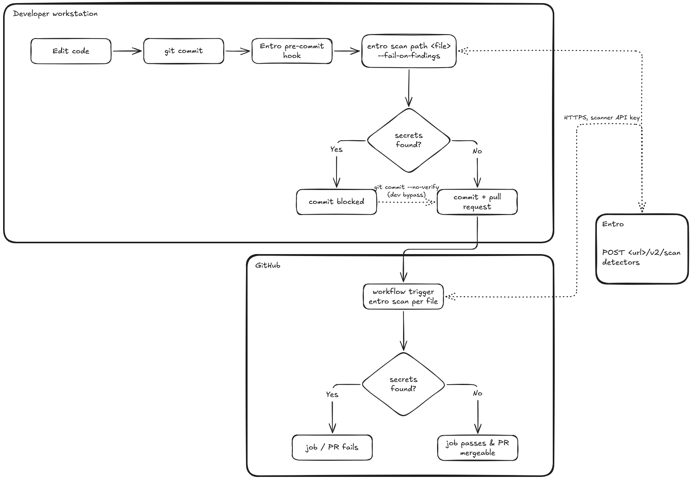

# Entro CLI & Pre-Commit Hook Demo

Shows how the [Entro CLI and pre-commit hook](https://docs.entro.security/knowledge-base/shift-left/entro-cli-and-pre-commit-hook)
stop exposed secrets at two points: on the developer's machine (pre-commit) and in CI (GitHub Actions).

> ⚠️ Every credential in `demo-app/` is **fake**. They are formatted like real ones so Entro's detectors fire,
> but none of them work. (Entro ignores obvious placeholders such as "dummy" or "example", so the files
> deliberately don't label them as fake.)

## Flow

The pre-commit hook scans staged files on the developer machine. A commit that gets through, including one made with `--no-verify`, is scanned again by GitHub Actions on the pull request. Both call the Entro scan API.



## What's in the repo

| Path | Purpose |
| --- | --- |
| `demo-app/.env.production` | Fake Stripe key, Slack webhook, DB URI with password, generic API secret |
| `demo-app/config.py` | Fake AWS access key + secret, GitHub token |
| `demo-app/deploy.sh` | Fake registry password and Base64 `Authorization: Basic` header |
| `demo-app/main.py` | Clean file, scans with 0 findings (control) |
| `.githooks/pre-commit` | Local hook: scans staged files with `entro scan path` and blocks the commit |
| `scripts/install-hooks.sh` | Enables the hook (`git config core.hooksPath .githooks`) |
| `scripts/entro-ci-scan.sh` | Scans a list of files in CI, annotates findings, writes the job summary. Blocks or warns based on `ENTRO_FAIL_MODE` |
| `.github/workflows/entro-secret-scan.yml` | The GitHub Actions pipeline |
| `flow-diagram.png` | Diagram of the pre-commit hook and the CI scan |

## Setup

1. **Create an Entro Scanner API key** (scope: Scanner API only) in the Entro platform.
2. **Add GitHub repository secrets** (Settings → Secrets and variables → Actions):
   - `ENTRO_SECURITY_PLATFORM_TOKEN`: the scanner API key
   - `ENTRO_SECURITY_PLATFORM_URL`: the same platform URL your local `entro config` uses
3. **Install the Entro CLI locally** (macOS/Linux/WSL/Git Bash):
   ```bash
   curl -fsSL https://public-entro-security.s3.us-east-1.amazonaws.com/entro-cli/install-cli -o /tmp/install-entro-cli
   sh /tmp/install-entro-cli 2.0.16
   entro config --url <platform-url> --token <scanner-api-key>
   ```
4. **Choose how CI treats findings** (Settings → Secrets and variables → Actions → Variables):
   - Variable `ENTRO_FAIL_MODE`. Leave it unset, or set it to `block`, and the check fails when a secret is found.
   - Set it to `warn` and the check stays green: findings are still scanned, annotated as warnings, listed in the job summary, and sent to Entro. A bad token or a scan that cannot run still fails the job.

## Notes

- GitHub **push protection** may reject the push because these fake tokens match well-known formats
  (Stripe, Slack, GitHub, AWS). Either follow the bypass link GitHub prints ("it's a test secret") or turn off push
  protection for this demo repo. Entro's findings are unaffected.
- To scan your own commit history rather than files, the CLI also has `entro scan git <repo_path>`.
